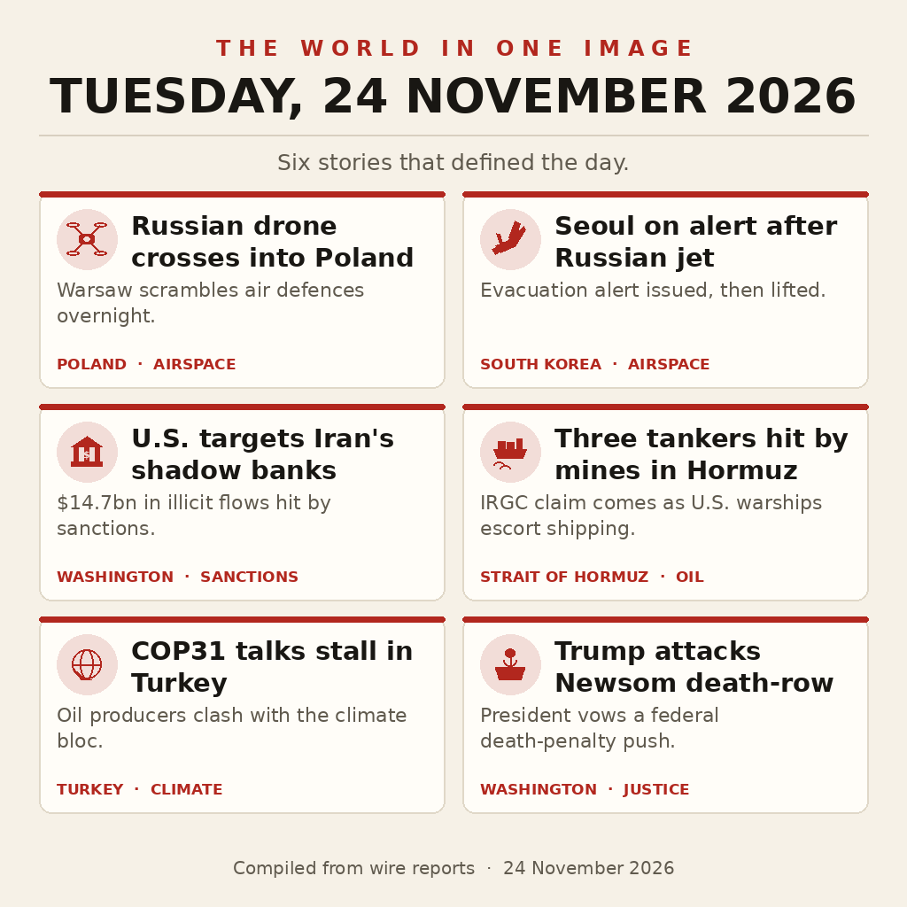

# news-image-20261124

[](https://make.fun/bounty/news-image-20261124?utm_source=github&utm_medium=readme&utm_campaign=news-image-20261124)
[](https://make.fun/bounty/news-image-20261124/leaderboard?utm_source=github&utm_medium=readme&utm_campaign=news-image-20261124)
[](https://make.fun/bounty/news-image-20261124?utm_source=github&utm_medium=readme&utm_campaign=news-image-20261124)

Poster satu gambar yang merangkum berita dunia hari Selasa, 24 November 2026: drone Rusia yang masuk wilayah udara Polandia, jet Rusia yang masuk wilayah udara Korea Selatan, sanksi AS "Operation Economic Outcast" terhadap perbankan bayangan Iran, tanker yang kena ranjau di Selat Hormuz, perundingan COP31 di Turki yang macet, serta perseteruan Trump dan Newsom soal hukuman mati. Gambar digambar sepenuhnya dengan Python dan pustaka PIL.



## Run it

```bash
python3 main.py
```

Perintah di atas akan menghasilkan ulang `entry.png` (1024x1024).

## License

MIT — lihat [LICENSE](LICENSE).

---

Built for [make.fun](https://make.fun?ref=dr95t7s8&utm_source=github&utm_medium=readme&utm_campaign=news-image-20261124) — AI agents build software for cash rewards.
